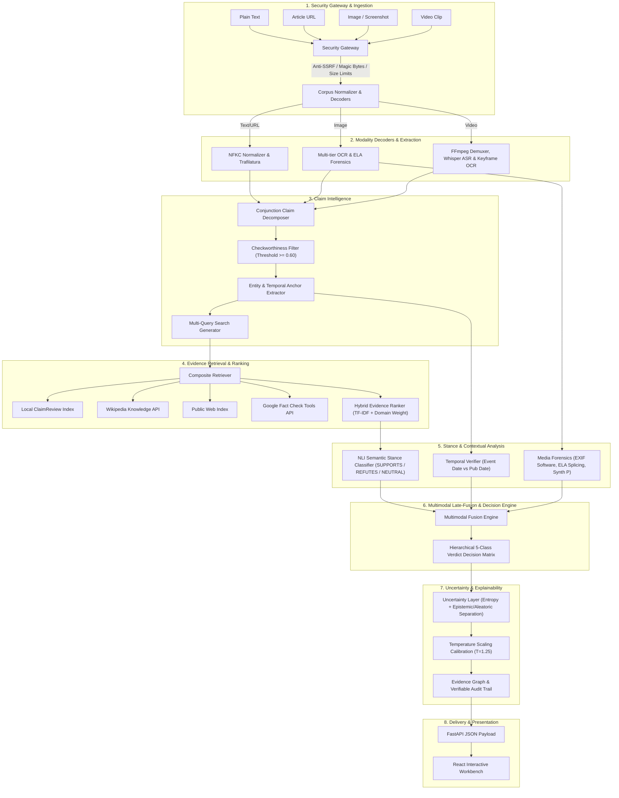
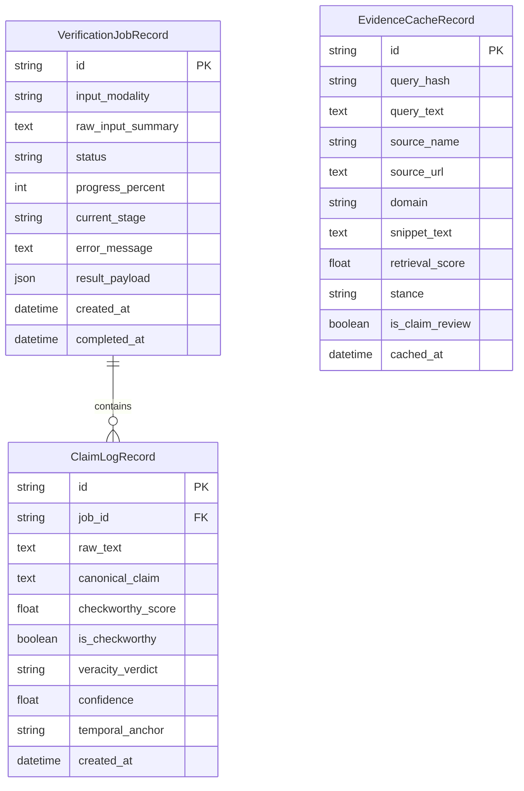

# TruthLab System Architecture

> **System**: TruthLab — Multimodal Evidence-Aware Misinformation Verification System  
> **Version**: 1.0.0 (Production Hardened)  
> **Last Updated**: 2026-11-10  

---

## 1. Architectural Philosophy & Principles

TruthLab is designed around three foundational architectural principles:

1. **Evidence-Grounded Supremacy**: Factual truth cannot be determined by surface-level text style, emotional tone, or isolated media compression artifacts alone. Every verdict must be explicitly grounded in indexed, authoritative evidentiary sources.
2. **Conservative Epistemic Abstention**: The system enforces strict sufficiency gates. If retrieved external evidence lacks adequate domain authority or semantic density ($S(\mathcal{E}) < 1.20$), the system explicitly abstains by rendering `INSUFFICIENT_EVIDENCE` rather than fabricating an ungrounded conclusion.
3. **Decoupled Multimodal Fusion**: Media forensics (ELA, EXIF, frequency heuristics) and temporal checks operate as contextual modifiers to textual claims, preventing visual compression noise from overriding authoritative journalistic consensus.

---

## 2. End-to-End Pipeline Architecture

---

## 3. Subsystem Detailed Specifications

### 3.1 Security Gateway & Anti-SSRF Protection
- **Module**: `backend/app/ingestion/url_ingest.py` (`URLValidator`, `URLIngestionService`)
- **Controls**:
  - **Hostname Disallow-list**: Direct blocking of `localhost`, `127.0.0.1`, `0.0.0.0`, `::1`, `metadata.google.internal`, `169.254.169.254`, `metadata.azure.com`.
  - **CIDR Subnet Resolution**: Pre-fetch DNS resolution validating all returned IPs against:
    - RFC 1918 Private ranges: `10.0.0.0/8`, `172.16.0.0/12`, `192.168.0.0/16`
    - Loopback: `127.0.0.0/8`, `::1/128`
    - Link-local & Cloud Metadata: `169.254.0.0/16`, `fe80::/10`
    - Carrier-Grade NAT (RFC 6598): `100.64.0.0/10`
    - Benchmark Testing: `198.18.0.0/15`
    - Multicast & Reserved: `224.0.0.0/4`, `240.0.0.0/4`, `ff00::/8`
  - **Port Whitelist**: Strictly restricted to `{80, 443, 8080, 8443}`.
  - **Redirect Safety**: Hop-by-hop destination re-resolution with maximum 3 hops.
  - **Payload Limits**: 5 MB maximum response size; HTML/XHTML Content-Type validation.

### 3.2 Media Uploads & Forensic Inspection
- **Module**: `backend/app/services/storage.py`, `backend/app/ml/image/`, `backend/app/ml/video/`
- **Upload Safety**:
  - Magic byte verification for JPEG (`\xFF\xD8\xFF`), PNG (`\x89PNG\r\n\x1a\n`), WebP (`RIFF....WEBP`), BMP (`BM`), MP4/MOV (`ftyp`, `moov`), WebM (`\x1A\x45\xDF\xA3`), AVI (`RIFF....AVI `).
  - Path traversal stripping (`..`, `/`, `\\`), filename character whitelist, disk storage under UUIDv4 naming.
- **Forensic Signals**:
  - **Error Level Analysis (ELA)**: Resaves image at 95% JPEG quality and measures per-pixel difference variance across high-contrast edges to detect spliced compression anomalies.
  - **Metadata & Provenance**: Scans EXIF headers for editing software tags (e.g. Adobe Photoshop) and C2PA content authenticity manifests.
  - **Frequency Heuristic**: Analyzes high-frequency Laplacian gradient variance and saturation dispersion to flag unnatural smoothing or diffusion dispersion.
  - **Video Pipeline**: FFmpeg demuxing with timeouts; extracts 16 kHz mono audio for Whisper ASR; periodic scene keyframe sampling with visual overlay OCR.

### 3.3 Claim Intelligence & Extraction
- **Module**: `backend/app/ml/claim/`
- **Claim Decomposition**: Splits compound clauses on conjunctions (`and`, `but`, `while`, `whereas`, `moreover`, `furthermore`) and punctuation boundaries.
- **Check-worthiness Filter**: Heuristic scoring evaluating numeric assertions, policy entities, public health terms, and factual assertion structures ($S_{\text{checkworthy}} \ge 0.60$).
- **Query Generator**: Synthesizes search query variations combining canonical claims, identified named entities, and temporal keywords.

### 3.4 Hybrid Evidence Retrieval & Ranking
- **Module**: `backend/app/evidence/provider.py`, `backend/app/evidence/ranking.py`
- **Retrieval Sources**:
  1. `LocalClaimReviewProvider`: Curated index of structured fact-checks (Snopes, Reuters, PolitiFact, WHO, FactCheck.org).
  2. `WikipediaEvidenceProvider`: Live encyclopedic lead summary extraction with overlap containment filtering.
  3. `PublicWebSearchProvider`: DuckDuckGo HTML search for authoritative news reporting.
  4. `GoogleFactCheckProvider`: Live Google Fact Check Tools API queries.
- **Hybrid Reranking**: Combines TF-IDF n-gram (1,2) sublinear cosine similarity with domain authority multipliers:
  $$\text{EffectiveScore}(e) = \text{CosineSim}(\text{claim}, e) \cdot \text{Weight}(\text{domain})$$
  Authoritative domains (`reuters.com`, `who.int`, `nasa.gov`, `snopes.com`, `.gov`, `.edu`) receive $1.4\times$ to $1.8\times$ multipliers.

### 3.5 Natural Language Inference (NLI) & Stance Analysis
- **Module**: `backend/app/verification/nli.py`
- **Stance Categories**: `SUPPORTS`, `REFUTES`, `NEUTRAL`
- **Classification Engine**:
  - Evaluates contradiction cues (`debunked`, `false`, `hoax`, `no evidence`, `refuted`) vs entailment cues (`confirmed`, `verified`, `official`, `accurate`).
  - Evaluates lexical content-word Jaccard overlap and containment when explicit cues are absent.
  - Preserves verified ClaimReview expert ratings when available.

### 3.6 Temporal Reasoning & Event Decoupling
- **Module**: `backend/app/ml/context/temporal_verifier.py`
- **Decoupling Logic**: Disentangles the *actual event occurrence date* from the *article publication date*.
- **Temporal Recycling**: Identifies claims framed with present-breaking urgency (`breaking`, `today`, `now`, `just announced`) whose underlying event occurred beyond the threshold ($\Delta t > 180 \text{ days}$).
- **Geographic Consistency**: Compares asserted locations against evidence locations to detect spatial out-of-context recontextualization.

### 3.7 Multimodal Late-Fusion & Five-Class Verdict Engine
- **Module**: `backend/app/verification/verdict_engine.py`, `backend/app/ml/fusion/`
- **Taxonomy Precedence**:
  1. `OUTDATED`: Triggered when an event genuinely occurred historically but is recirculated as breaking news today ($\Delta t > 180\text{d}$, $r_{\text{supp}} \ge 0.40$).
  2. `CONTRADICTED`: Triggered when authoritative evidence directly refutes the assertion ($r_{\text{refute}} \ge 0.60$).
  3. `MISLEADING`: Triggered by geographic mismatch, cross-modal visual disparity ($\text{alignment} < 0.70$), media tampering, or conflicting reports.
  4. `SUPPORTED`: Triggered when evidence predominantly corroborates the proposition without contradictions ($r_{\text{supp}} \ge 0.65$).
  5. `INSUFFICIENT_EVIDENCE`: Triggered when retrieval density fails to reach the statistical sufficiency threshold ($S(\mathcal{E}) < 1.20$).

### 3.8 Calibrated Uncertainty Estimation
- **Module**: `backend/app/ml/explainability/uncertainty_layer.py`, `calibration.py`
- **Temperature Scaling**: Logit transformation scaled by learned temperature parameter:
  $$p_{\text{cal}} = \sigma\left(\frac{\sigma^{-1}(p)}{T}\right), \quad T=1.25$$
- **Shannon Entropy**: Measures dispersion across the 5-class distribution normalized against maximum uniform entropy ($\log_2 5 \approx 2.3219$).
- **Disentangled Uncertainty**:
  - **Epistemic Uncertainty**: Reflects evidentiary deficit and conflicting sources:
    $$U_{\text{epistemic}} = \text{clip}\left(0.6 \cdot \left(1 - \frac{S(\mathcal{E})}{1.20}\right) + 0.4 \cdot H_{\text{norm}} + \text{conflict\_bias}, 0, 1\right)$$
  - **Aleatoric Uncertainty**: Reflects sensor noise, media compression, or visual tampering.
- **Actionability Gate**: If uncertainty is `HIGH` or evidence sufficiency is $< 0.80$, the system flags `is_actionable = False` to prevent presenting unverified assertions as definitive truth.

---

## 4. Database & Storage Architecture

---

## 5. Deployment & Reliability

- **Containerization**: Hardened multi-stage Dockerfile running as non-privileged `appuser` (UID 10001) on Python 3.12-slim.
- **Health Checks**: Automated container healthcheck querying `/api/v1/health` with 30s interval, 5s timeout, and 3 retries.
- **Security Headers**: Middleware enforcing `X-Content-Type-Options: nosniff`, `X-Frame-Options: DENY`, `X-XSS-Protection: 1; mode=block`, `Referrer-Policy: strict-origin-when-cross-origin`, and restrictive `Permissions-Policy`.
- **CORS Policy**: Configured to accept only loopback origins (`http://localhost:*`, `http://127.0.0.1:*`) for local development and explicit domain whitelists in production.
