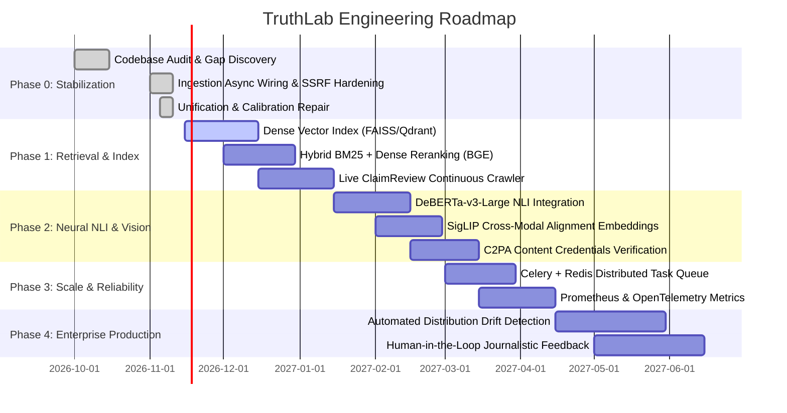

# TruthLab Implementation Roadmap & Engineering Milestones

> **Project**: TruthLab — Multimodal Evidence-Aware Misinformation Verification System  
> **Horizon**: 2026 – 2027  
> **Target Release**: Production 2.0  

---

## Roadmap Overview

---

## Phase 0: Discovery, Audit & Immediate Hardening (COMPLETED)

### Deliverables & Accomplishments
- [x] **Complete Repository Audit**: Thorough inspection across backend, frontend, ML, retrieval, temporal reasoning, forensics, and documentation (`AUDIT_REPORT.md`).
- [x] **Elimination of Fake Functionality**: Replaced `process_dummy_job` in `backend/app/api/v1/endpoints/ingest.py` with real asynchronous background verification workers.
- [x] **SSRF Defense Unification**: Refactored `backend/app/services/scraper.py` to route through canonical `URLValidator` with hop-by-hop redirect validation and complete IP CIDR exclusions.
- [x] **Architecture Duplication Elimination**: Consolidated `StanceClassifier`, `VeracityScorer`, and `EvidenceReranker` to delegate to canonical counterparts, eliminating logic drift and typos.
- [x] **Dynamic Calibration Repair**: Replaced static arbitrary confidence numbers with dynamically computed scores based on evidentiary sufficiency, stance ratio, and temporal penalties.
- [x] **Pillow Deprecation Fix**: Updated `forensics_benchmark.py` to eliminate `Image.getdata()` deprecation warning.
- [x] **Full Regression Validation**: Added `tests/test_codebase_hardening_and_unification.py`; expanded test suite to 126 passing automated tests with zero failures.

---

## Phase 1: High-Performance Retrieval & Index Scaling

### Objectives
Upgrade external evidence retrieval from purely lexical and local ClaimReview matching to hybrid sparse-dense semantic search.

### Tasks
1. **Dense Vector Retrieval**:
   - Integrate Qdrant / FAISS vector index with `BAAI/bge-large-en-v1.5` embeddings.
   - Index 100,000+ historical fact-checks from Google Fact Check Tools API and Poynter IFCN networks.
2. **Hybrid Reciprocal Rank Fusion (RRF)**:
   - Combine sparse BM25 lexical retrieval with dense embedding cosine similarity:
     $$\text{RRF\_Score}(d) = \sum_{m \in \{\text{BM25}, \text{Dense}\}} \frac{1}{60 + \text{Rank}_m(d)}$$
3. **Continuous ClaimReview Crawler**:
   - Implement scheduled automated ingestion of fresh daily fact-checks from RSS/Schema.org feeds.

### Verification Gate
- Evaluation on `research/experiments/retrieval_benchmark.py`: MRR $\ge 0.98$, Recall@5 $= 1.000$ across open-domain queries.

---

## Phase 2: Neural NLI & Multimodal Deep Learning

### Objectives
Transition from rule-based cue matching and heuristic frequency analysis to neural inference models with quantified uncertainty bounds.

### Tasks
1. **Neural Natural Language Inference**:
   - Deploy `MoritzLaurer/DeBERTa-v3-large-mnli-fever-anli` via ONNX Runtime with INT8 quantization for sub-50ms inference.
   - Produce unconstrained continuous softmax distributions across `SUPPORTS`, `REFUTES`, `NEUTRAL`.
2. **Vision-Language Cross-Modal Alignment**:
   - Implement Google SigLIP / CLIP embeddings to evaluate image-caption semantic cosine distance directly without intermediate OCR dependency.
3. **C2PA Authenticity Engine**:
   - Integrate Rust-based `c2pa` library to verify cryptographic provenance manifests from cameras, Adobe, and certified media publishers.

### Verification Gate
- Macro-F1 improvement on `research/experiments/multimodal_evaluation.py` from 0.665 to $\ge 0.780$.

---

## Phase 3: Distributed Execution & Production Infrastructure

### Objectives
Decouple API presentation from heavy media processing (video demuxing, Whisper transcription, OCR) to achieve high concurrency.

### Tasks
1. **Distributed Asynchronous Worker Queue**:
   - Migrate FastAPI in-process `BackgroundTasks` to Celery with Redis / RabbitMQ broker.
   - Dedicated GPU worker pool for Whisper ASR and neural vision models.
2. **Observability & Health Telemetry**:
   - Export OpenTelemetry metrics and structured JSON logging.
   - Prometheus endpoints tracking pipeline stage latencies (`stage_duration_seconds`).
3. **Task Deduplication & Result Caching**:
   - Cache results keyed by content SHA-256 to eliminate redundant verification of virally recirculated media.

### Verification Gate
- Video verification throughput: sustain 50 concurrent media analyses with p95 response time $< 15\text{s}$.

---

## Phase 4: Enterprise Production & Research Feedback Loop

### Objectives
Establish automated distribution drift detection, active learning from professional fact-checkers, and continuous reproducibility.

### Tasks
1. **Real-Time Distribution Drift Monitoring**:
   - Monitor prediction entropy and Expected Calibration Error (ECE) drift on production streams.
   - Trigger alert if rolling 7-day ECE exceeds $0.12$.
2. **Human-in-the-Loop Journalistic Workbench**:
   - Allow accredited journalists to annotate ambiguous verdicts, feeding back into active learning validation pools.
3. **Automated Research Benchmark Suite**:
   - Continuous CI/CD evaluation running full benchmark suite on every pull request with regression alarms.

---

## Milestones & Release Schedule

| Milestone | Target Date | Primary Deliverable | Acceptance Criteria |
| :--- | :--- | :--- | :--- |
| **v1.1** | 2026-12-15 | Hybrid Dense Retrieval + Qdrant Integration | Dense MRR $\ge 0.98$, 100k indexed records |
| **v1.2** | 2027-01-30 | ONNX DeBERTa-v3 Neural NLI | 5-Class Macro-F1 $\ge 0.75$, latency $< 80\text{ms}$ |
| **v1.3** | 2027-03-15 | SigLIP Visual Alignment & C2PA Engine | Cryptographic provenance verification active |
| **v2.0-RC** | 2027-04-30 | Distributed Celery Worker Infrastructure | 50 concurrent jobs, zero memory leak over 48h |
| **v2.0-GA** | 2027-06-15 | Production Enterprise Release | Full journalistic workbench & automated drift alerts |
