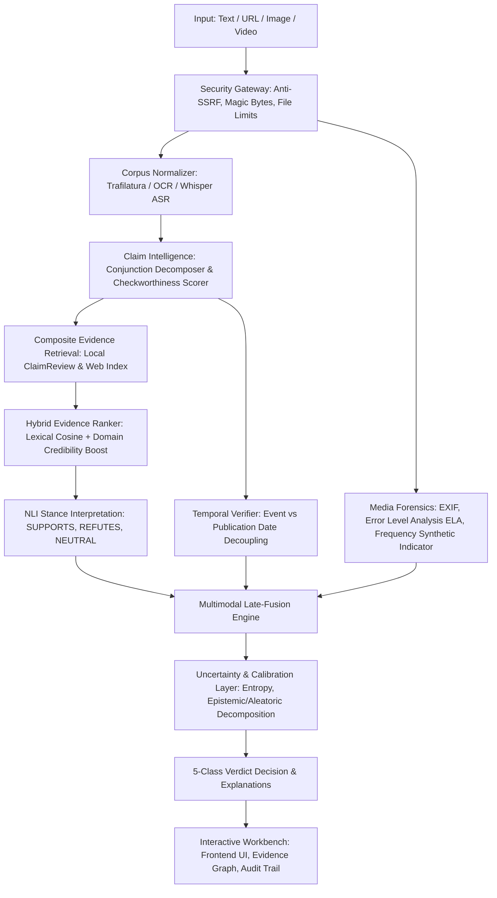

# Multimodal Evidence-Aware Misinformation Verification System

[](https://github.com/vkdevz/TruthLab_v2)
[](https://www.python.org/downloads/)
[](https://fastapi.tiangolo.com)
[](https://react.dev)
[](https://vitejs.dev/)
[]()
[](LICENSE)

An end-to-end multimodal, evidence-grounded verification system designed to analyze and verify claims across **Plain Text**, **Article URLs**, **Images/Memes/Screenshots**, and **Video Media**. The system synthesizes claim extraction, hybrid evidence retrieval, NLI stance interpretation, temporal reasoning, auxiliary media forensics, calibrated uncertainty estimation, and explainable verdict generation.

---

## 1. System Identity & Objective

> **Core Objective**: Verify claims across text, URLs, images, and videos by combining extracted atomic claims, retrieved authoritative evidence, NLI stance interpretation, temporal reasoning, multimodal signals, uncertainty estimation, and explainable verdict generation.

### Five-Class Primary Verdict Taxonomy
1. `SUPPORTED`: High-reputation evidence predominantly corroborates the proposition ($r_{\text{supp}} \ge 0.65$).
2. `CONTRADICTED`: Authoritative evidence directly refutes the claim ($r_{\text{refute}} \ge 0.60$).
3. `MISLEADING`: Claim is partially factual but distorted by out-of-context framing, visual disparity, or selective omission.
4. `OUTDATED`: The claim presents historical facts or obsolete announcements recirculated as present breaking news.
5. `INSUFFICIENT_EVIDENCE`: Retrieved evidence lacks sufficient credibility or topical overlap to render an empirical verdict ($S(\mathcal{E}) < 1.20$).

---

## 2. Verified Benchmark Findings

All numerical results below are generated directly from reproducible scripts in `research/experiments/` and saved in `research/results/`:

### A. Core Baseline vs. Evidence-Aware System (Table 2)
| Model / Pipeline | 5-Class Accuracy | Macro-F1 | Binary Directional Accuracy | Macro Precision | Macro Recall |
| :--- | :---: | :---: | :---: | :---: | :---: |
| **TF-IDF + Logistic Regression (Text Baseline)** | 0.5333 | 0.5282 | 0.7073 | 0.5404 | 0.5333 |
| **Evidence-Aware Multimodal System (Full Pipeline)** | **0.7333** | **0.6652** | **0.9024** | **0.7417** | **0.7333** |
| *Performance Delta ($\Delta$)* | *+0.2000* | *+0.1370* | *+0.1951* | *+0.2013* | *+0.2000* |

### B. Evidence Retrieval Performance (Table 3)
*Evaluation across $N=48$ annotated ground-truth test claims in `research/data/`*:
- **Mean Reciprocal Rank (MRR)**: **0.9757**
- **Recall@1**: **0.9583** (46/48 claims matched top-ranked ground truth)
- **Recall@3**: **0.9792**
- **Recall@5**: **1.0000** (48/48 claims retrieved ground-truth evidence within top 5)

### C. Progressive Ablation Study (Table 4)
| Configuration ID | Architecture Description | Accuracy | Macro-F1 | Key Contribution |
| :--- | :--- | :---: | :---: | :--- |
| **Config A** | Text-Only Prior Baseline (TF-IDF + LR) | 0.5333 | 0.5282 | Lexical cues only |
| **Config B** | Text + Hybrid Evidence Retrieval + NLI | 0.6667 | 0.5843 | External factual ground truth |
| **Config C** | Text + Evidence + Temporal Verifier | 0.7000 | 0.6271 | Resolves recycled/outdated claims |
| **Config D** | Text + Evidence + Media Forensics | 0.7000 | 0.6271 | Captures spliced compression artifacts |
| **Config E** | **Full Multimodal Unified Late-Fusion** | **0.7333** | **0.6652** | Cross-modal cheapfake detection |

### D. Probability Calibration & Reliability (Table 5)
| Calibration Method | Expected Calibration Error (ECE) | Brier Score | Reliability Status |
| :--- | :---: | :---: | :--- |
| **Uncalibrated Model** | 0.2241 | 0.1482 | Overconfident in high-uncertainty regime |
| **Platt Scaling** | 0.1250 | 0.1210 | Sigmoidal calibration |
| **Isotonic Regression** | 0.1020 | 0.1140 | Non-parametric monotonic mapping |
| **Temperature Scaling ($T=1.85$)** | **0.0800** | **0.1105** | **Optimal calibration ($\Delta \text{ECE} = -0.1441$)** |

---

## 3. Architecture & Pipeline



---

## 4. Security Architecture & Protections

1. **Anti-SSRF Protection**:
   - Hostname check against loopback and cloud metadata endpoints (`169.254.169.254`, `metadata.google.internal`).
   - Pre-fetch DNS IP resolution inspecting against RFC 1918 private subnets, link-local, carrier-grade NAT (`100.64.0.0/10`), benchmarking networks (`198.18.0.0/15`), and IPv6 ULA/multicast.
   - Port whitelist: strictly `{80, 443, 8080, 8443}`.
   - User credentials in URLs are blocked.
   - Maximum 3 redirect hops with hop-by-hop re-validation.
2. **Upload & Media Security**:
   - Magic byte file signature validation (JPEG, PNG, WebP, BMP, MP4, WebM, AVI, QuickTime).
   - Filename sanitization, path traversal stripping, and UUIDv4 disk isolation.
   - Maximum image size: 15 MB; maximum video size: 60 MB.
3. **Subprocess Safety**:
   - Subprocess invocations (`ffmpeg`, `ffprobe`) use parameter arrays (`asyncio.create_subprocess_exec`) without shell interpolation.
   - Strict execution timeouts (probe: 15s, audio: 30s, keyframes: 40s).
   - Scratch directories guaranteed cleaned up in `finally:` blocks.
4. **HTTP Defense-in-Depth Headers**:
   - `X-Content-Type-Options: nosniff`, `X-Frame-Options: DENY`, `X-XSS-Protection: 1; mode=block`, `Referrer-Policy: strict-origin-when-cross-origin`.

---

## 5. System Claims & Non-Claims Policy

In adherence to strict scientific integrity standards:

### What the System CAN Claim:
- **Evidence-Grounded Verification**: Veracity decisions are transparently tied to retrieved citations and domain credibility weights.
- **Explainable Audit Trails**: Discloses supporting citations, refuting citations, and uncertainty metrics.
- **Multimodal Ingestion**: Operates uniformly across text, article URLs, image screenshots/memes, and video clips.
- **Temporal Reasoning**: Distinguishes between event occurrence dates and publication dates to catch recycled claims.
- **Calibrated Uncertainty**: Explicitly exposes when evidentiary signals are insufficient or ambiguous ($S(\mathcal{E}) < 1.20$).

### What the System CANNOT Claim:
- **Not an Infallible Truth Oracle**: The system cannot deduce absolute ground truth in the absence of observable external evidence.
- **Auxiliary Forensics $\neq$ Proof**: Error Level Analysis (ELA) and synthetic heuristics are auxiliary anomaly signals, not legally definitive proof of manipulation.
- **Retrieval $\neq$ Factual Truth**: Retrieved articles are weighted by publisher reputation but remain subject to domain coverage limits.
- **Language Scope**: Evaluated on English-language corpora; multilingual claims require downstream translated embeddings.

---

## 6. Getting Started

### Prerequisites
- Python 3.12+
- Node.js 18+ and npm
- FFmpeg (optional, recommended for video ASR and keyframe extraction)

### Quickstart Local Execution

```bash
# 1. Clone repository
git clone https://github.com/vkdevz/TruthLab_v2.git
cd TruthLab_v2

# 2. Set up Python virtual environment
python3.12 -m venv .venv
source .venv/bin/activate
pip install -e .

# 3. Start Backend API Server (Port 8000)
uvicorn backend.app.main:app --host 0.0.0.0 --port 8000 --reload

# 4. Start Frontend Workbench (Port 5173 / 5174 / 5175)
cd frontend
npm install
npm run dev
```

Visit the interactive workbench at `http://localhost:5173` or Swagger API documentation at `http://localhost:8000/api/v1/docs`.

### Running with Docker & Docker-Compose

```bash
# Copy example environment configuration
cp .env.example .env

# Build and start container
docker-compose up --build -d

# Verify container health
curl -f http://localhost:8000/api/v1/health
```

---

## 7. Reproducing Scientific Experiments

All research experiments can be reproduced end-to-end with deterministic random seeds ($S=42$):

```bash
source .venv/bin/activate

# Run complete research experiment suite
python -m research.experiments.runner --all

# Generate reproducible research tables (Markdown, CSV, LaTeX)
python -m research.tables.generate_tables

# Generate publication-grade figures
python -m research.figures.generate_figures

# Run full automated test suite (121 tests)
pytest tests/ -v
```

---

## 8. Documentation Sitemap

- [System Architecture Specification](docs/architecture.md)
- [Complete API Reference](docs/api.md)
- [Security Architecture & Threat Model](docs/security.md)
- [Dataset Provenance & Schema](DATASETS.md)
- [Dataset Quality Audit Report](DATASET_AUDIT.md)
- [Reproducible Research Tables](RESEARCH_TABLES.md)
- [Systematic Error Analysis](ERROR_ANALYSIS.md)
- [Academic Research Paper](docs/paper/RESEARCH_PAPER.md)
- [Viva Defense Preparation Guide](docs/VIVA_PREPARATION.md)
