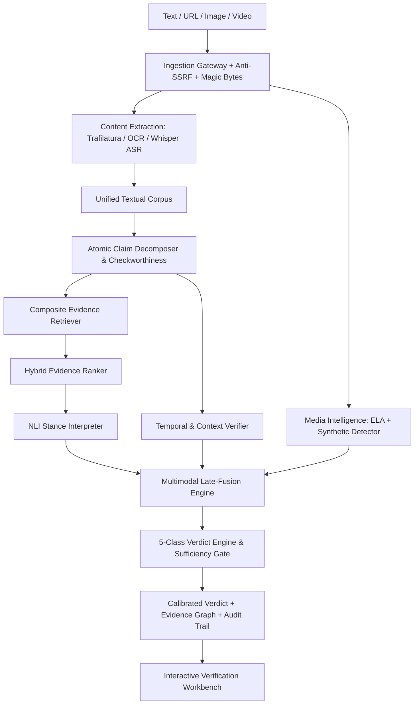

# Multimodal Evidence-Aware Misinformation Verification System

[](https://www.python.org/downloads/)
[](https://fastapi.tiangolo.com)
[](https://react.dev)
[](https://vitejs.dev/)
[](https://www.python.org/downloads/)
[](https://fastapi.tiangolo.com)
[](https://react.dev)
[](https://vitejs.dev/)
[]()
[](https://creativecommons.org/licenses/by/4.0/)

A major final-year engineering and scientific research project investigating multimodal evidence-grounded information verification. The system unifies plain text, article URLs, images/screenshots, and videos into a coherent, evidence-retrieval pipeline capable of discerning:
1. **Media Authenticity** (probabilistic visual/audio manipulation indicators)
2. **Claim Veracity** (5-class taxonomy: `SUPPORTED`, `CONTRADICTED`, `MISLEADING`, `OUTDATED`, `INSUFFICIENT_EVIDENCE`)
3. **Contextual & Temporal Integrity** (anachronism and out-of-context recycling detection)
4. **Evidence Sufficiency & Calibration** (epistemic uncertainty estimation with structured audit trails)

---

## Phase 2 Status: COMPLETED (`v0.2-phase2-multimodal-intelligence`)

Phase 2 elevates the system into a unified multimodal and temporal verification platform:
**TEXT / URL / IMAGE / VIDEO → UNIFIED CORPUS → CLAIMS → EVIDENCE → TEMPORAL + FORENSICS → MULTIMODAL LATE FUSION → VERDICT**

- [x] Secure Media Ingestion with Magic Byte Signatures, MIME validation & path sanitization
- [x] Image Intelligence: EXIF/metadata, Error Level Analysis (ELA), probabilistic synthetic detector interface
- [x] Image OCR & Normalized Text Ingestion for claim extraction
- [x] Video Intelligence: Technical FFmpeg metadata probe, Whisper ASR speech transcription
- [x] Video Keyframe Extraction & Overlay Chyron OCR with timestamp preservation
- [x] Temporal Verifier: Decoupled event vs source dates, out-of-context recycling detection
- [x] Multimodal Late-Fusion: Evidentiary refutation dominance, cheapfake mismatch detection
- [x] Multimodal Workbench Frontend: Video/image preview, OCR/ASR inspection, clear factual vs forensic signal separation
- [x] 68/68 Automated Tests Passing (zero regressions from Phase 1)

---

## Architecture Overview



---

## Directory Layout

```
.
├── backend/
│   └── app/
│       ├── api/v1/         # Endpoints & routing (verify/text, verify/url, verification/{id})
│       ├── core/           # Configuration & security settings
│       ├── db/             # SQLAlchemy async models & SQLite persistence
│       ├── evidence/       # Abstract EvidenceProvider, ranking, composite retriever
│       ├── ingestion/      # Anti-SSRF URLValidator and text normalizer
│       ├── ml/             # Claim decomposer, checkworthiness, NLI, forensics
│       ├── repositories/   # Async CRUD repository for verification records
│       ├── schemas/        # Pydantic v2 domain schemas
│       └── services/       # Pipeline service orchestrator & job manager
├── frontend/               # Vite + React (TypeScript) verification workbench (Port 5175)
├── data/                   # Reference ClaimReview and benchmark datasets
├── docs/                   # Complete research, architecture, experiment, and API docs
│   ├── architecture.md     # Modular monolith architecture specifications
│   ├── verification-pipeline.md # Complete verification pipeline data flow
│   ├── datasets.md         # Documented datasets, splits, and baseline findings
│   ├── api.md              # API endpoint documentation
│   └── experiments/        # Actual measured latency and baseline metric logs
├── scripts/                # Data preparation and pipeline profiling scripts
├── tests/                  # 53 automated unit and integration tests
└── pyproject.toml          # Python package definitions
```

---

## Quickstart

### 1. Backend Setup
```bash
# Recommended: Create and activate Python 3.12 venv
python3 -m venv .venv
source .venv/bin/activate

# Install dependencies
pip install -e .

# Run complete test suite (68 tests)
PYTHONPATH=. pytest tests/

# Start FastAPI development server
uvicorn backend.app.main:app --reload --port 8000
```
Interactive API documentation: `http://localhost:8000/api/v1/docs`

### 2. Frontend Setup
```bash
cd frontend
npm install
npm run dev -- --port 5175
```
Verification Workbench UI: `http://localhost:5175`

---

## Reproducible Research Baseline & Benchmarks

Run the text baseline training and evaluation:
```bash
PYTHONPATH=. python3 backend/app/ml/baseline/train_baseline.py
```
- In-Domain Train Metrics: Accuracy: 1.000, Macro F1: 1.000, ECE: 0.399
- Out-of-Domain Test Metrics: Accuracy: 0.700, Precision: 0.750, Recall: 0.600, Macro F1: 0.697, ECE: 0.184
- Metrics logged to: `docs/experiments/baseline_results.json`

Run pipeline latency profiling:
```bash
PYTHONPATH=. python3 tests/profile_phase2_performance.py
```
- Latency profile logged to: `docs/experiments/pipeline_latency.json`

---

## Documentation Links
- [System Architecture](docs/architecture.md)
- [Verification Pipeline](docs/verification-pipeline.md)
- [Image Intelligence & Forensics](docs/image-intelligence.md)
- [Video Intelligence & ASR](docs/video-intelligence.md)
- [Temporal & Context Verification](docs/temporal-verification.md)
- [Multimodal Late-Fusion Engine](docs/multimodal-fusion.md)
- [Media Ingestion Security](docs/media-security.md)
- [API Reference](docs/api.md)
- [Dataset Documentation](docs/datasets.md)
- [Database Schema](docs/architecture/database_schema.md)
