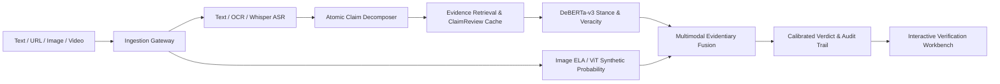

# Multimodal Evidence-Aware Misinformation Verification System

[](https://www.python.org/downloads/)
[](https://fastapi.tiangolo.com)
[](https://react.dev)
[](https://creativecommons.org/licenses/by/4.0/)

A major final-year engineering and scientific research project investigating multimodal evidence-grounded information verification. The system unifies plain text, article URLs, images/screenshots, and videos into a coherent, evidence-retrieval pipeline capable of discerning:
1. **Media Authenticity** (probabilistic visual/audio manipulation indicators)
2. **Claim Veracity** (5-class taxonomy: `SUPPORTED`, `CONTRADICTED`, `MISLEADING`, `OUTDATED`, `INSUFFICIENT_EVIDENCE`)
3. **Contextual & Temporal Integrity** (anachronism and out-of-context recycling detection)
4. **Evidence Sufficiency & Calibration** (epistemic uncertainty estimation with structured audit trails)

---

## Architecture Overview



---

## Directory Layout

```
.
├── backend/
│   └── app/
│       ├── api/v1/         # Endpoints & routing
│       ├── core/           # Configuration & security settings
│       ├── db/             # SQLAlchemy async models & migrations
│       ├── ml/             # ML inference pipelines (NLI, Claim, Forensics, Fusion)
│       ├── schemas/        # Pydantic v2 domain schemas
│       └── services/       # Ingestion, scraping, storage, task runners
├── frontend/               # Vite + React (TypeScript) verification workbench
├── docs/                   # Full research, architecture, experiment, and paper docs
│   ├── research/           # Problem formulation, taxonomy, literature survey
│   ├── architecture/       # Detailed component designs and data flows
│   ├── experiments/        # Controlled benchmark logs and ablation records
│   └── paper/              # LaTeX thesis / paper source
├── tests/                  # Automated pytest test suites
└── pyproject.toml          # Python package definitions
```

---

## Quickstart

### 1. Backend Setup
```bash
# Recommended: Create and activate a Python 3.12 venv
python3 -m venv .venv
source .venv/bin/activate

# Install dependencies
pip install -e .

# Run test suite
pytest tests/

# Start FastAPI development server
uvicorn backend.app.main:app --reload --port 8000
```
Interactive API documentation: `http://localhost:8000/api/v1/docs`

### 2. Frontend Setup
```bash
cd frontend
npm install
npm run dev
```
Verification Workbench UI: `http://localhost:5173`

---

## Research Publications & Reproducibility
- [Problem Formulation](docs/research/problem_formulation.md)
- [5-Class Veracity Taxonomy](docs/research/taxonomy_definition.md)
- [Evaluation Protocol](docs/research/evaluation_protocol.md)
- [Literature Matrix & Dataset Licensing](docs/research/literature_matrix.md)
