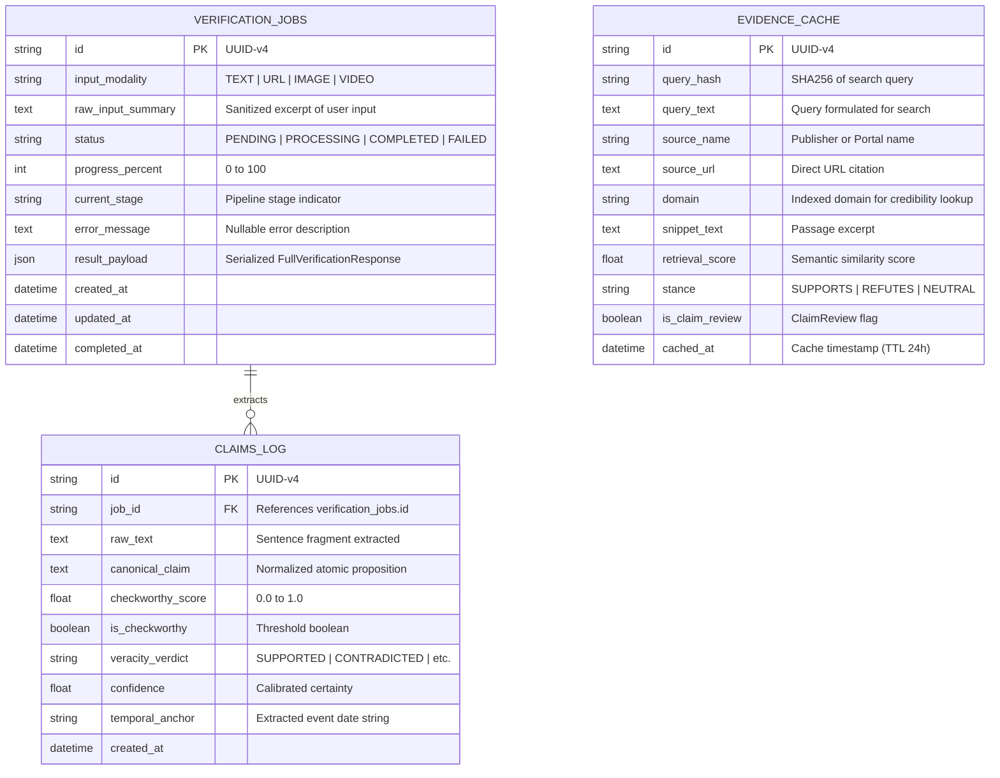

# Database Schema & Data Models
## Multimodal Evidence-Aware Misinformation Verification System

---

## 1. Relational Schema Architecture

The persistence layer uses SQLite (via `aiosqlite` and `SQLAlchemy 2.0 Async`) for the modular monolith. It provides ACID transactions, zero external server processes, and high-speed local caching.

---

## 2. Indices & Performance Optimization

1. **`verification_jobs.id`**: Primary Key (UUIDv4) for $O(1)$ async polling queries.
2. **`claims_log.job_id`**: B-tree index for efficient batch retrieval of all claims linked to a verification job.
3. **`evidence_cache.query_hash`**: SHA-256 hash index preventing redundant external API calls for duplicate claims across sessions.
4. **`evidence_cache.domain`**: B-tree index enabling instantaneous domain reputation lookups.
