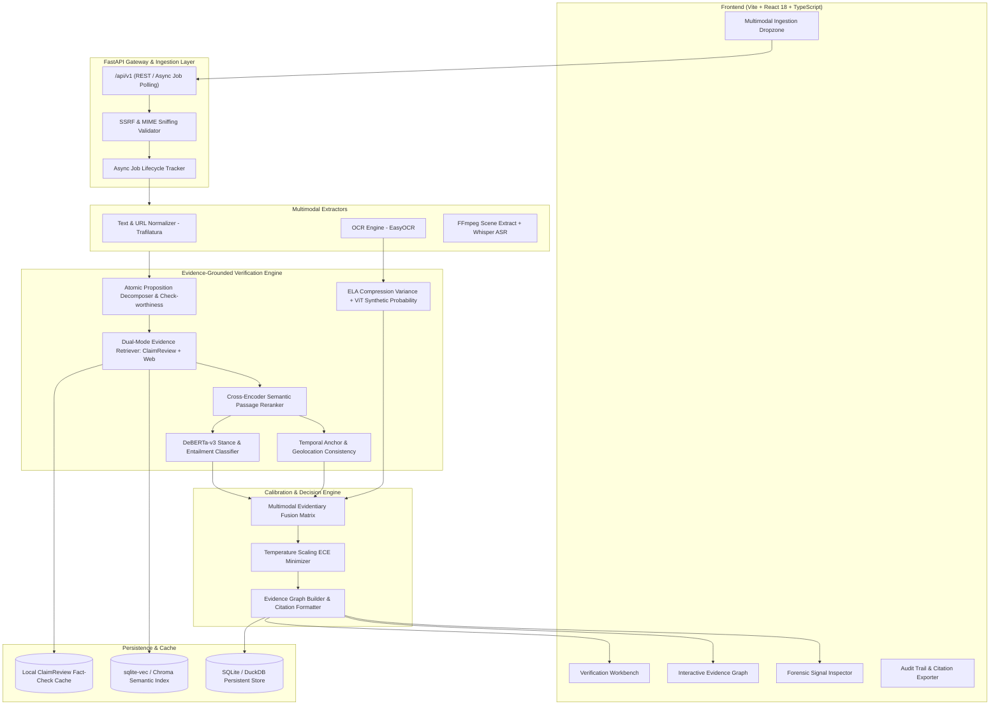

# Target System Architecture & Component Design
## Multimodal Evidence-Aware Misinformation Verification System

---

## 1. Modular Monolith Architecture

The system is organized into decoupled layers operating within a unified Python/TypeScript monorepo. This design eliminates microservice overhead, inter-service network latency, and deployment complexity while maintaining strict domain boundaries.

---

## 2. Component Boundaries & Responsibilities

| Subsystem | Primary Python Module | Input | Output | Key Tech |
| :--- | :--- | :--- | :--- | :--- |
| **Ingestion Gateway** | `backend.app.services.scraper` | URL, raw text, uploaded files | Sanitized text / media scratch file | `trafilatura`, `httpx`, `python-magic` |
| **Job Manager** | `backend.app.services.job_manager` | Task invocation | Job UUID, progress state, error handling | `asyncio`, `sqlite` |
| **Claim Intelligence** | `backend.app.ml.claim` | Unified text corpus | List of check-worthy atomic propositions | `spacy`, `transformers` |
| **Evidence Retrieval** | `backend.app.services.retrieval` | Formulated queries | Top-$k$ ranked evidence passages | Google Fact Check API, Tavily, `sqlite-vec` |
| **NLI & Stance** | `backend.app.ml.nli` | (Claim, Evidence) pairs | Entailment / Contradiction logits | `cross-encoder/nli-deberta-v3-base` |
| **Temporal Verification** | `backend.app.ml.context` | Claim date, Evidence dates | Temporal mismatch delta, `OUTDATED` flag | `dateparser`, `python-dateutil` |
| **Image Forensics** | `backend.app.ml.image` | Image bitmap | ELA error map, EXIF tags, synthetic probability | `easyocr`, `pillow`, `torch` |
| **Video Intelligence** | `backend.app.ml.video` | MP4 video | Transcript, Key-frames, Video OCR | `ffmpeg-python`, `scenedetect`, `whisper` |
| **Evidence Fusion** | `backend.app.ml.fusion` | Stance, Temporal, Forensics | Calibrated 5-class verdict | Decision matrix, Logistic meta-learner |
| **Audit Explainer** | `backend.app.ml.explainability` | Fusion verdict & citations | Structured audit JSON, Evidence graph | `networkx`, Pydantic v2 |
