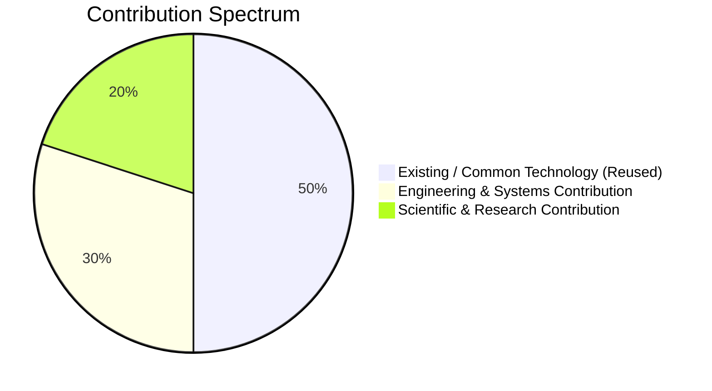

# Literature Survey & Dataset Licensing Matrix
## Multimodal Evidence-Aware Misinformation Verification System

---

## 1. Comparative Benchmark & Dataset Matrix

| Dataset / Benchmark | Primary Paper / Authors | Modality | Primary Task | Scale | License / Availability | Train/Test Leakage Hazards |
| :--- | :--- | :--- | :--- | :--- | :--- | :--- |
| **FEVER** (Fact Extraction and VERification) | Thorne et al. (NAACL 2018) | Text | Fact Extraction & Stance (3-class) | 185,445 claims | Creative Commons Attribution-ShareAlike 4.0 (CC BY-SA 4.0) | Wikipedia page overlap; must split strictly by Wikipedia entity. |
| **MultiFC** | Augenstein et al. (EMNLP 2019) | Text + Metadata | Multi-domain real-world fact checking | 34,924 claims from 26 fact-checking portals | Open Academic Research License | Domain leakage across portals; split by publisher required. |
| **LIAR** | Wang (ACL 2017) | Text + Metadata | Fine-grained veracity (6-class) | 12,836 statements | Open Academic (UCSB) | Historical political statements; temporal overlap requires attention. |
| **ClaimReview Corpus** | Data Commons / Google Fact Check Tools | Text + Structured JSON | Real-world fact-checks aggregated globally | >120,000 live claims | Open Data Commons Attribution License (ODC-BY) | Ongoing real-time additions; must freeze snapshot timestamp for reproducibility. |
| **CIFAKE** | Bird et al. (2023) | Image | Real vs. Synthetic Image Classification | 60,000 32x32 images (CIFAR-10 based) | CC BY 4.0 | Low resolution; useful for initial baseline, not representative of high-res social media deepfakes. |
| **Factify 1 & 2** | Mishra et al. (De-Factify @ AAAI 2022/2023) | Multimodal (Text + Image) | 5-way Multimodal Fact Verification | 50,000 claim-evidence pairs | Academic Research Use | Complex claim-image-document bindings; requires careful pairing logic. |
| **Fakeddit** | Nakamura et al. (LREC 2020) | Multimodal (Text + Image) | Fine-grained multimodal fake news (6-class) | >1,000,000 Reddit posts | MIT / Open Academic License | Subreddit style bias; text often satirical rather than factual. |

---

## 2. Scientific Contribution Boundaries

To preserve academic integrity and pass defense/peer review, the system clearly partitions its technical layers into three categories:

### 2.1 Existing / Common Technology (Not Claimed as Novel)
- **OCR Engine**: Pre-trained EasyOCR and Tesseract models.
- **Speech Recognition (ASR)**: OpenAI Whisper (`base.en` / `small`).
- **NLI Backbone**: Pre-trained DeBERTa-v3 or RoBERTa fine-tuned on MNLI.
- **Syntactic Parsing**: SpaCy dependency matchers for English grammar.
- **Search Infrastructure**: Standard search APIs (Google Fact Check Tools, Tavily, DuckDuckGo).
- **Web Scraping**: Trafilatura / Readability content extraction.

### 2.2 Engineering Contributions (Novel System Integration)
1. **Unified Multimodal Ingestion Pipeline**: A single, robust, asynchronous pipeline that transparently ingests plain text, URLs, images, screenshots, and videos, normalizing all sensory streams into a structured, verifiable claim representation.
2. **Deterministic Anti-Hallucination Audit Trail**: A citation-grounded explanation engine that quotes exact passages and URLs from verified fact-checks rather than delegating final verdicts to generative LLMs that risk hallucination.
3. **Hardware-Optimized Solo Developer Architecture**: A modular monolith architecture running locally on Apple Silicon (M2 MPS / CPU) that achieves full multimodal verification in $< 15$ seconds without requiring multi-node GPU clusters.

### 2.3 Research Contributions (Scientific Inquiries to be Validated)
1. **Evidence-Grounded vs. Closed-Book Verification ($RQ_1$)**: Empirical demonstration and quantification of the performance gap between conventional text-only fake-news classifiers and an evidence-retrieval pipeline when evaluated on out-of-domain and emerging news topics.
2. **Temporal Recontextualization Resolution ($RQ_2$)**: Formalization and validation of an automated temporal-anchor verification layer that reliably catches "recycled genuine news" (the dominant real-world misinformation vector) which standard NLI falsely entices as true.
3. **Continuous Probabilistic Media Authenticity Fusion ($RQ_3$)**: Formulating a late-fusion decision matrix that integrates probabilistic visual forensics (ELA, synthetic artifacts) with semantic claim verification, proving that continuous calibration avoids the catastrophic false-positive rates of thresholded deepfake classifiers.

---

## 3. Related Work Positioning

Unlike traditional papers that focus either *exclusively* on NLP text classification (e.g., Thorne et al., Wang) or *exclusively* on pixel-level computer vision deepfake detection (e.g., Rossler et al., FaceForensics++), this project investigates **cross-modal evidentiary convergence**:
- The image may be completely authentic, but the caption is false.
- The image may be synthetic, but illustrating an empirically verified factual claim.
- The claim may be true, but occurring in 2019 rather than 2026.

By modeling these cross-modal orthogonal dimensions inside a unified decision tree, our system addresses the real vulnerabilities exploited by modern disinformation campaigns.
