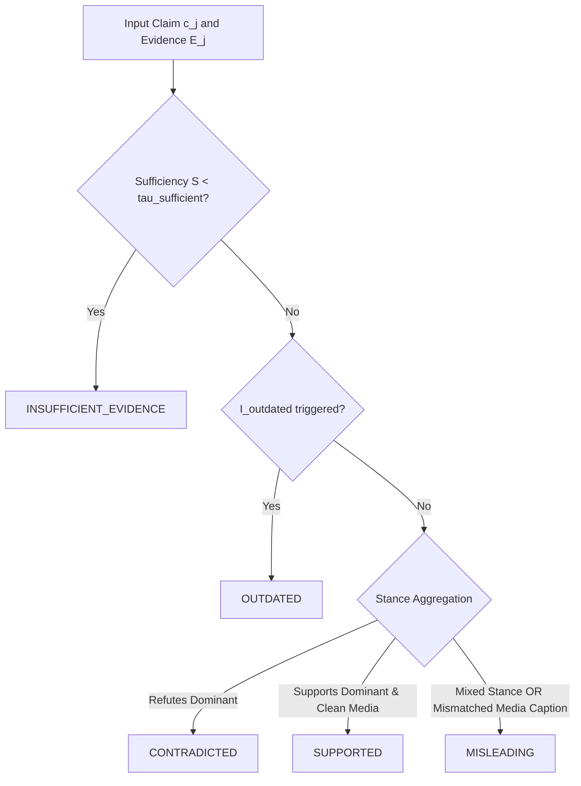

# Mathematical Problem Formulation
## Multimodal Evidence-Aware Misinformation Verification System

---

## 1. Abstract System Objective

Let an incoming multi-modal user submission be represented as an arbitrary input tuple:
$$\mathcal{X} = \langle x_{\text{text}}, x_{\text{url}}, x_{\text{img}}, x_{\text{vid}} \rangle$$
where any component $x_i$ may be null or present.

The primary objective of the system is not to compute a naive binary classification $f(\mathcal{X}) \in \{0, 1\}$, but rather to:
1. Extract and decompose verifiable atomic factual claims: $\mathcal{C} = \{c_1, c_2, \dots, c_m\}$.
2. For each claim $c_j \in \mathcal{C}$, retrieve a set of relevant external evidence documents/passages: $\mathcal{E}_j = \{e_{j,1}, e_{j,2}, \dots, e_{j,k}\}$.
3. Extract temporal anchors and publication context: $\mathcal{T}(\mathcal{X})$ and $\mathcal{T}(\mathcal{E}_j)$.
4. Extract probabilistic media authenticity/forensic indicator vectors: $\mathbf{m}_{\text{img}} \in [0, 1]^{d_{\text{img}}}$ and $\mathbf{m}_{\text{vid}} \in [0, 1]^{d_{\text{vid}}}$.
5. Model the joint posterior probability distribution over a discrete 5-class veracity taxonomy $\mathcal{Y}$:
$$\mathcal{Y} = \{\text{SUPPORTED}, \text{CONTRADICTED}, \text{MISLEADING}, \text{OUTDATED}, \text{INSUFFICIENT\_EVIDENCE}\}$$

$$\hat{y}_j = \arg\max_{y \in \mathcal{Y}} P(y \mid c_j, \mathcal{E}_j, \mathcal{T}, \mathbf{m})$$

accompanied by a calibrated epistemic uncertainty score $u(c_j) \in [0, 1]$ and an extractive audit trail $\mathcal{A}_j$.

---

## 2. Mathematical Formalization of Pipeline Stages

### 2.1 Content Normalization & Atomic Claim Extraction
Let $\Phi_{\text{ingest}}$ denote the multimodal transcription and normalization function:
$$\mathcal{S} = \Phi_{\text{ingest}}(\mathcal{X}) = \text{Concat}\Big(\text{Norm}(x_{\text{text}}), \text{Scrape}(x_{\text{url}}), \text{OCR}(x_{\text{img}}), \text{ASR}(x_{\text{vid}})\Big)$$

The claim extraction operator $\Psi_{\text{decompose}}$ decomposes unstructured string $\mathcal{S}$ into atomic propositions:
$$\mathcal{C} = \Psi_{\text{decompose}}(\mathcal{S}) = \{c_1, c_2, \dots, c_m\}$$
subject to the check-worthiness constraint:
$$\forall c_j \in \mathcal{C}, \quad P(\text{check-worthy} \mid c_j) \ge \tau_{\text{cw}}$$
where $\tau_{\text{cw}} \in [0, 1]$ is a tunable operational threshold (typically set to $0.60$).

### 2.2 Evidence Retrieval and Semantic Reranking
For each check-worthy claim $c_j$, query formulation produces a set of semantic queries $Q_j = \{q_{j,1}, \dots, q_{j,p}\}$.
A retrieval function $\Omega_{\text{retrieve}}$ queries the local fact-check index $\mathcal{D}_{\text{FC}}$ and external search indices $\mathcal{D}_{\text{Web}}$:
$$\mathcal{D}_{\text{candidate}} = \Omega_{\text{retrieve}}(Q_j)$$

A cross-encoder scoring function $R(c_j, d)$ assigns a relevance score to each candidate document $d \in \mathcal{D}_{\text{candidate}}$:
$$s_r(c_j, d) = \sigma\Big(\mathbf{w}_r^T \cdot \text{CrossEncoder}(c_j, d)\Big)$$
The top-$k$ ranked evidence set is defined as:
$$\mathcal{E}_j = \operatorname{Top-}k_{d \in \mathcal{D}_{\text{candidate}}} s_r(c_j, d)$$

### 2.3 Stance Detection and Natural Language Inference (NLI)
For each evidence snippet $e_{j,l} \in \mathcal{E}_j$, an NLI cross-encoder computes conditional entailment probabilities:
$$\mathbf{p}_{\text{NLI}}(c_j, e_{j,l}) = \text{Softmax}\Big(\mathbf{z}_{\text{entail}}, \mathbf{z}_{\text{neutral}}, \mathbf{z}_{\text{contradict}}\Big) \in \Delta^2$$
where $\Delta^2$ is the 2-simplex ($\sum p_i = 1$).

We aggregate evidence stance using relevance-weighted pooling:
$$\bar{\mathbf{p}}_{\text{NLI}}(c_j) = \sum_{l=1}^k \tilde{w}_l \cdot \mathbf{p}_{\text{NLI}}(c_j, e_{j,l}), \quad \tilde{w}_l = \frac{\exp(s_r(c_j, e_{j,l}) / \tau)}{\sum_{l'} \exp(s_r(c_j, e_{j,l'}) / \tau)}$$

### 2.4 Temporal & Contextual Inconsistency Modeling
Let $t(c_j)$ denote the extracted or inferred event timestamp of claim $c_j$, and $t(e_{j,l})$ denote the publication timestamp of evidence $e_{j,l}$.
Let $t_{\text{claim}}$ be the user-asserted timeline. We define the temporal discrepancy function $\Delta_t$:
$$\Delta_t(c_j, \mathcal{E}_j) = \min_{l} |t_{\text{claim}} - t(e_{j,l})|$$

If an event is verified as factually true historically ($p_{\text{entail}} \approx 1$), but $\Delta_t > \tau_{\text{outdated}}$ and the claim is framed as contemporaneous ("happening right now"), the temporal recontextualization indicator is triggered:
$$I_{\text{outdated}}(c_j) = \mathbb{I}\Big(\bar{p}_{\text{entail}}(c_j) > \theta_E \land \Delta_t(c_j, \mathcal{E}_j) > \tau_{\text{outdated}}\Big)$$

### 2.5 Media Authenticity Signal Integration
Unlike deterministic digital signatures, visual forensic algorithms output continuous probabilities:
$$p_{\text{synthetic}}(x_{\text{img}}) = \sigma(f_{\text{ViT}}(x_{\text{img}}))$$
$$p_{\text{spliced}}(x_{\text{img}}) = g_{\text{ELA}}(x_{\text{img}})$$

The media manipulation feature vector is formed as:
$$\mathbf{m}(\mathcal{X}) = \big[ p_{\text{synthetic}}, p_{\text{spliced}}, I_{\text{metadata\_tampered}}, p_{\text{frame\_inconsistency}} \big]^T$$

### 2.6 Evidence Sufficiency Thresholding
Let the evidence sufficiency metric $S(\mathcal{E}_j)$ be defined as:
$$S(\mathcal{E}_j) = \sum_{l=1}^{|\mathcal{E}_j|} s_r(c_j, e_{j,l}) \cdot \text{Credibility}(e_{j,l}.\text{domain})$$
If $S(\mathcal{E}_j) < \tau_{\text{sufficient}}$, the claim is partitioned into $\text{INSUFFICIENT\_EVIDENCE}$ regardless of heuristic classifier predictions, preventing ungrounded speculation.

---

## 3. Decision Boundary Hierarchy

The taxonomy verdict $\hat{y}$ is computed via a hierarchical rule and calibrated scoring engine:

---

## 4. Confidence Calibration

To prevent overconfidence, predicted logits $\mathbf{z}$ are calibrated using learned Temperature Scaling:
$$\hat{\mathbf{p}}_{\text{calibrated}} = \text{Softmax}\left(\frac{\mathbf{z}}{T^*}\right)$$
where $T^* > 0$ is optimized on validation data to minimize the Negative Log-Likelihood (NLL) and Expected Calibration Error (ECE):
$$\text{ECE} = \sum_{b=1}^B \frac{|B_b|}{N} \Big| \text{acc}(B_b) - \text{conf}(B_b) \Big|$$
Target: $\text{ECE} < 0.08$ on all benchmark splits.
