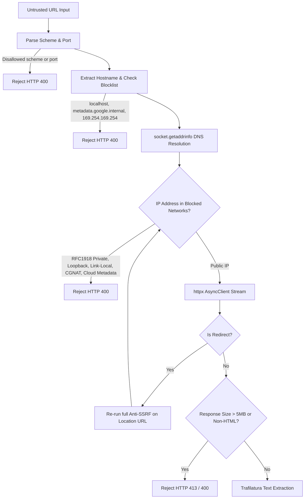

# Security Architecture & Threat Defense Model

## 1. Threat Model & Security Scope

The **Multimodal Evidence-Aware Misinformation Verification System** processes untrusted user inputs across text, URLs, images, and videos. Operating in adversarial information environments exposes verification systems to specialized threat vectors:

| Attack Vector | Target Subsystem | Severity | Defensive Mechanism |
| :--- | :--- | :--- | :--- |
| **Server-Side Request Forgery (SSRF)** | URL Ingestion (`/verify/url`) | Critical | Pre-fetch DNS IP resolution, private/cloud CIDR blocklist, redirect hop re-validation, port whitelisting |
| **Path Traversal / Arbitrary Write** | Media Storage (`/verify/image`, `/verify/video`) | High | Filename scrubbing, basename isolation, UUIDv4 keying on disk, root path pinning |
| **Malicious Media / Polyglot Files** | Media Storage & Processing | High | Magic byte file signature verification, strict MIME validation, size limits |
| **Subprocess Command Injection** | Video Processor (`ffmpeg`, `ffprobe`) | Critical | Executable argument arrays (`create_subprocess_exec`), zero shell interpolation, explicit timeouts |
| **Denial of Service / Zip-Bombing** | Ingestion & Subprocesses | High | Bounded streaming reads (15MB image, 60MB video, 5MB HTML), 90s max video duration, frame limits |
| **Clickjacking / MIME Sniffing** | Web API Responses | Medium | HTTP security headers (`nosniff`, `DENY`, `strict-origin-when-cross-origin`) |
| **Privilege Escalation** | Container Runtime | High | Unprivileged non-root execution (`appuser:10001`) |

---

## 2. Anti-SSRF Defense Architecture

The URL ingestion engine (`backend/app/ingestion/url_ingest.py`) implements defense-in-depth protection before establishing outbound HTTP connections:

### Blocked Network Ranges & Addresses
- **RFC 1918 Private Networks**: `10.0.0.0/8`, `172.16.0.0/12`, `192.168.0.0/16`
- **Loopback**: `127.0.0.0/8`, `::1/128`
- **Cloud Metadata & Link-Local**: `169.254.0.0/16`, `fe80::/10`, `metadata.google.internal`, `instance-data`
- **Carrier-Grade NAT (RFC 6598)**: `100.64.0.0/10`
- **Benchmarking & Documentation**: `198.18.0.0/15`, `192.0.2.0/24`, `198.51.100.0/24`, `203.0.113.0/24`, `2001:db8::/32`
- **Multicast & Reserved**: `224.0.0.0/4`, `240.0.0.0/4`, `ff00::/8`, `fc00::/7`
- **IPv4-Mapped IPv6**: Recursively unmapped and checked against IPv4 rules.
- **Port Restrictions**: Whitelist strictly permits `{80, 443, 8080, 8443}`. Arbitrary internal ports (e.g. 6379, 9200, 22) are blocked.
- **Credential Stripping**: URLs containing user-info (`user:pass@host`) are rejected immediately.

---

## 3. Media Ingestion & Storage Hardening

Implemented in `backend/app/services/storage.py`:

### 3.1 Magic Byte File Signature Verification
Extensions and HTTP `Content-Type` headers are user-controlled and untrustworthy. The storage layer inspects initial file headers directly:
- **JPEG**: `\xFF\xD8\xFF`
- **PNG**: `\x89PNG\r\n\x1a\n`
- **WebP**: `RIFF....WEBP` header structure
- **BMP**: `BM`
- **MP4 / QuickTime**: `ftyp`, `moov`, `mdat`, or `wide` within first 32 bytes
- **WebM / MKV**: `\x1A\x45\xDF\xA3` EBML container header
- **AVI**: `RIFF....AVI `

Files failing signature checks are unlinked and rejected with `HTTP 400 Bad Request`.

### 3.2 Filename Sanitization & Traversal Prevention
- Directory traversal patterns (`..`, `/`, `\`) and null bytes (`\x00`) are stripped.
- Basenames are sanitized using `re.sub(r"[^a-zA-Z0-9_\-\.]", "_", ...)`.
- On disk, files are stored using unguessable UUIDv4 identifiers: `uploads/{uuid4}.{ext}`.

### 3.3 Resource Limits & Lifecycle Cleanup
- Maximum image size: **15 MB**
- Maximum video size: **60 MB**
- Maximum video duration: **90 seconds**
- Temporary processing scratch directories are managed with `tempfile.mkdtemp(prefix="video_proc_")` and guaranteed cleaned up via `finally: shutil.rmtree(..., ignore_errors=True)`.
- Automatic upload purge deletes orphaned files older than 2 hours.

---

## 4. Subprocess Isolation & Command Safety

External system dependencies (`ffmpeg`, `ffprobe`) are invoked with strict bounds:
- **Zero Shell Interpolation**: All invocations use `asyncio.create_subprocess_exec(*args)` with parameter arrays. `shell=True` and string formatting into shell commands are strictly prohibited.
- **Process Timeouts**:
  - Technical probe: **15 seconds**
  - Audio extraction: **30 seconds**
  - Keyframe extraction: **40 seconds**
- **Output Paging & DevNull**: Subprocess stdout/stderr are directed to `subprocess.DEVNULL` or read with bounded buffers to prevent memory exhaustion.

---

## 5. HTTP & Container Hardening

### 5.1 Defense-in-Depth Response Headers
Every response emitted by the FastAPI application includes:
- `X-Content-Type-Options: nosniff`
- `X-Frame-Options: DENY`
- `X-XSS-Protection: 1; mode=block`
- `Referrer-Policy: strict-origin-when-cross-origin`
- `Permissions-Policy: camera=(), microphone=(), geolocation=()`

### 5.2 Container Execution Isolation
- Non-root user `appuser` (UID `10001`, GID `10001`).
- Minimal Debian base image (`python:3.12-slim`).
- Container health checking via `curl -f http://localhost:8000/api/v1/health`.
- Explicit docker-compose resource limits (CPU ceiling: 2.0, Memory ceiling: 2048MB).
